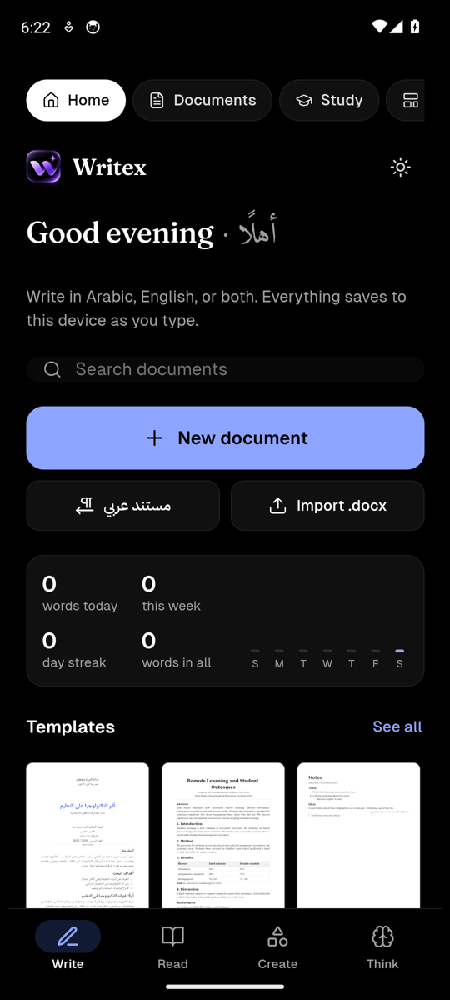
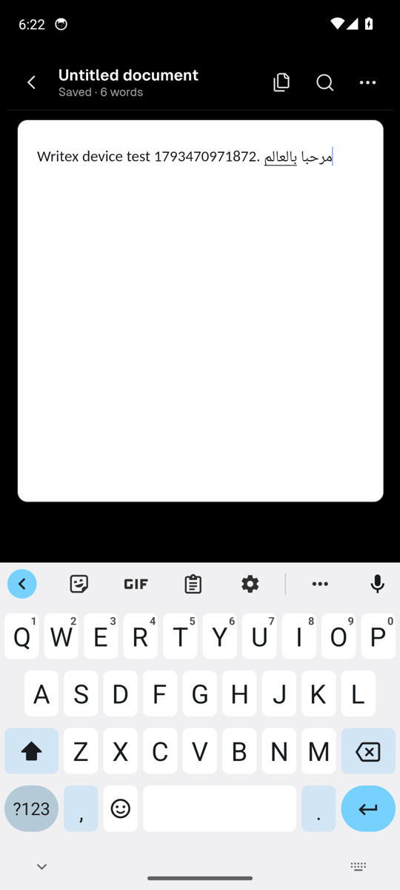
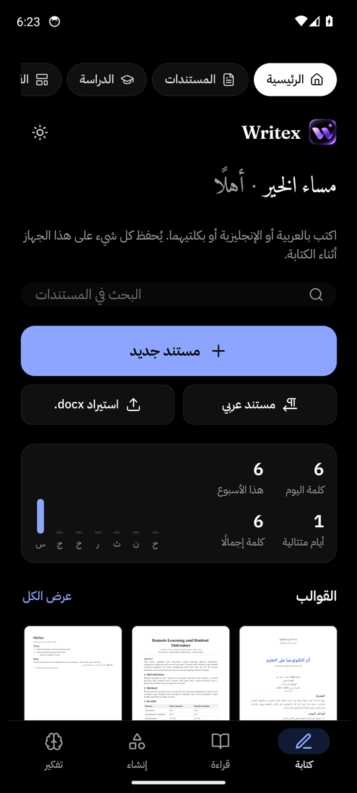
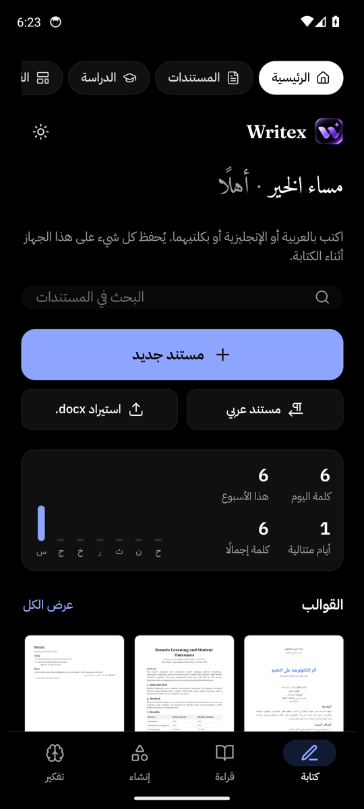

# Writex

**Write, read, create and think — in Arabic and English.**

Writex is a mobile-first document workspace for Android. It brings a Word-style editor with real pages, a reader for PDF and Word files, a studio for slides and study material, and a document companion together in one app. The app has a true AMOLED black interface, works fully in Arabic (right to left) or English, and keeps every document on your device.

<p align="center">
  
  
  
  
</p>

## Download

**[Download the latest Writex.apk](https://github.com/mostafa02235-sys/Writex/releases/latest/download/Writex.apk)**

Every push to `main` builds the APK on GitHub Actions and tests it on an Android 14 emulator. A build that passes is published on the [Releases page](https://github.com/mostafa02235-sys/Writex/releases).

### Installing on your phone

1. Open the link above on your Android phone and download `Writex.apk`.
2. Tap the downloaded file. If Android asks, allow your browser or Files app to **install unknown apps**.
3. Tap **Install**, then open Writex.

Later versions install over the old one and keep your documents.

## Features

| Section | What it does |
|---|---|
| **Write** | Rich-text editor with A4/Letter pages, headers and footers, page numbers, tables, images, drawings, equations (LaTeX), footnotes, citations (APA/MLA), table of contents, cover pages, find and replace, version history, crash recovery, password protection (AES-256), templates and study notebooks |
| **Read** | Opens PDF, Word (.docx), text and image files, with zoom, dark pages, search, read-aloud and a remembered page. Any file can be converted into an editable document |
| **Create** | Studio for presentations (with PowerPoint export), mind maps, diagrams, charts, infographics, study summaries and book covers. **Learn** offers spaced-repetition flashcards and quizzes made only from your document |
| **Think** | **Writex AI**: conversations with attached documents, PDFs and images; suggested actions (summarise, compare, find inconsistencies, extract tables, study guides, difficult quizzes, revision plans, research outlines, write a document); live task progress; and task history. The **document companion** chats with one document. |
| **Writex AI everywhere** | A floating Writex AI button in the editor (works on the selected text, the paragraph or the whole document, and never replaces text without confirmation). Writex AI also powers Studio, Learn and the companion. |

Exports: **PDF, Word (.docx), HTML, plain text, PowerPoint (.pptx) and PNG**. In the app, exported files are saved to **Documents › Writex** on your phone, and you can send any document through the Android share menu.

## Writex AI (private, on-device)

Writex AI runs **on the phone**: [llama.cpp](https://github.com/ggml-org/llama.cpp) is built into the app with a Qwen2.5 model you download once from Settings › Writex AI. After that it works **offline**, and documents and conversations never leave the device. There are no API keys, no AI subscriptions and no servers.

Writex AI powers:
- the writing assistant: improve, rewrite, grammar, spelling, expand, shorten, titles, tone, continue, organise;
- summaries and questions about long PDFs and Word files, which it reads in parts with real progress;
- comparisons and extraction;
- study summaries, exams (multiple choice, true/false, fill-in-the-blank), flashcards and revision plans;
- presentation outlines, mind maps and research outlines.

Details are in [docs/WRITEX_AI.md](docs/WRITEX_AI.md).

## Languages

- **English** and **العربية**, chosen in **Settings › Language**. By default the app follows your phone's language.
- In Arabic the whole interface switches to right to left: navigation, menus, sheets and back arrows.
- Documents keep their own direction. Each paragraph detects Arabic or English on its own, so you can mix both languages in one document.
- Every interface string is translated. `npm run i18n:check` fails the build if any string is missing its Arabic translation.

## Design

- True black (`#000000`) background with `#080808` and `#101010` surfaces. Black status and navigation bars save battery on OLED screens.
- The document paper stays white while you edit. An optional dark paper mode is in Settings, and exports are always white.
- A light theme is also available.
- Handles safe areas, the on-screen keyboard, and both portrait and landscape.

## Technology

| Layer | Used |
|---|---|
| UI | React 18 (UMD) + JSX bundled by esbuild |
| Editor | Quill 2 with custom formats (page breaks, footnotes, citations, TOC, bibliography, paragraph shading/borders) |
| Storage | IndexedDB inside the app (documents, files, versions, flashcards) |
| Files | pdf.js, mammoth, docx, jsPDF + html2canvas, PptxGenJS, MathJax |
| Native shell | Capacitor 7 (Android; iOS-ready) with App, Filesystem, Share, Status Bar, Splash Screen and Keyboard plugins |
| Fonts | Bundled with the app (Fontsource): Geist, IBM Plex Sans Arabic, Noto Naskh Arabic, Amiri, Cairo, Tajawal and more |

Every library and font is packaged in the APK, so the app works offline.

## Building it yourself

Requirements: **Node.js 20+**, **JDK 21** and the **Android SDK** (Android Studio is the easiest way to get both).

```bash
npm ci                     # install dependencies
npm run build              # build the web app into www/
npx cap sync android       # copy it into the Android project
npm run android:apply      # apply the Writex icons and launch screen
cd android && ./gradlew assembleDebug
# → android/app/build/outputs/apk/debug/app-debug.apk
```

Other commands:

| Command | Purpose |
|---|---|
| `npm run android:open` | Open the project in Android Studio |
| `npm run i18n:check` | List any interface text without an Arabic translation |
| `npm run icons` | Regenerate all icons from `assets/icon-source.png` (needs Python + Pillow) |
| `npm run build:artifact` | Single-file web version (`dist/writex.html`) |

## GitHub Actions

[`.github/workflows/build-android.yml`](.github/workflows/build-android.yml) runs on every push to `main` and can also be started by hand from the Actions tab. It has three jobs:

1. **Build APK**
   - Installs dependencies, checks the translations and builds the web app.
   - Syncs Capacitor and builds the APK with Gradle.
   - Verifies the APK's signature, package name, label and contents.
   - Uploads the APK as a build artifact.
2. **Install and test on an Android emulator**
   - Installs the APK and launches it.
   - Creates a document, types in it and checks that autosave writes it to storage.
   - Presses the Android back button, restarts the app and checks the document is still there.
   - Switches to Arabic, exports a PDF and a DOCX to `Documents/Writex`, and rotates to landscape.
   - Screenshots and logs are pushed to the `ci-results` branch.
3. **Publish**
   - Creates a GitHub Release with `Writex.apk` only after all jobs succeed.

The emulator job also tests the on-device Writex AI end to end. It installs the lightweight model through Settings, switches the network off, and checks:
- chat in English and Arabic;
- a writing task;
- answering a question about a PDF;
- reading a long document in parts;
- JSON flashcards;
- cancelling a task;
- freeing memory.

It also checks the empty-document hint with real keyboard input.

If signing secrets are set (see [docs/SIGNING.md](docs/SIGNING.md)), the workflow also builds a signed release APK and an **Android App Bundle (.aab)** for Google Play.

## Project structure

```
src/                 app source (React components, editor, storage, i18n)
  components/        screens: Library (Write), ReadSection, CreateSection, ThinkSection, Editor…
  locales/ar.js      Arabic translations
  i18n.js            language system (tr / trn, direction, locale)
  platform.js        native bridge: back button, lifecycle, file saving, sharing, status bar
  native/            Capacitor plugin imports (app build) and web stand-ins
styles/app.css       all styles, including the AMOLED theme and RTL rules
web/                 app HTML shell, web manifest and icons
assets/              supplied icon artwork and generated Android resources
android/             Capacitor Android project (open in Android Studio)
  app/src/main/cpp/  Writex AI engine: JNI bridge to llama.cpp (fetched by scripts/fetch-llama.sh)
  app/src/main/java/com/writex/app/ai/  model download, memory checks, inference plugin
scripts/             build, icon, translation-check and device-test scripts
docs/                signing, iOS and maintenance notes
```

## Known limitations

- **Writex AI** uses small on-device models (0.5B–3B). They are fast enough on phones and private, but less capable than large cloud models. They read text only (no images), and inference uses the CPU.
- **Voice typing and read-aloud** depend on the phone's WebView. Many Android WebViews don't provide speech recognition, and the app says so when it isn't available. The keyboard's microphone button always works.
- **Scanned PDFs** (images only) can be read but not searched or analysed. There's no text recognition (OCR) yet.
- **Reminders** show inside the app; phone notifications aren't set up yet.
- **Cloud sync** isn't set up. Documents stay on the device. Export to PDF or Word for backups.
- Builds are **debug-signed** until release signing secrets are added. They install and update normally, but Google Play needs the signed App Bundle.

## iOS

The project is ready for iOS through Capacitor; see [docs/IOS.md](docs/IOS.md).
